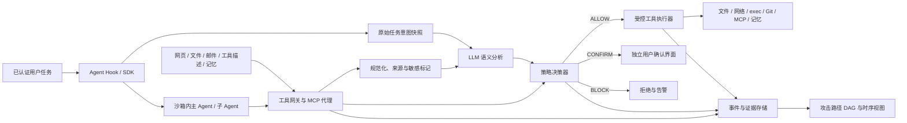

# Agent Guard 开发设计文档

> 对应赛题：[面向大模型智能体提示注入与工具滥用的检测防御技术](desc.md)。本文是开发蓝图，不代表系统已经实现或完成性能验证。

## 1. 目标与边界

系统对在线运行的 LLM Agent 提供“检测—研判—阻断—溯源”闭环，覆盖直接注入、外部内容间接注入、记忆污染、工具滥用及跨 MCP／子 Agent 调用。一次工具操作必须在执行前得到 `ALLOW`、`CONFIRM` 或 `BLOCK` 决策；事后能够说明原始任务、可疑内容来源、触发策略和实际影响。

首个可运行版本控制自建演示 Agent 的文件、网络、命令、Git、MCP、记忆及子 Agent 入口。接入第三方 Agent 时，Hook 和 MCP 代理负责可观测及策略拦截；若第三方 Agent 仍有未受控的本地工具或直接网络权限，不宣称覆盖这些操作。要实现强阻断，Agent 必须运行在受控沙箱内，或者由宿主环境提供等效的强制执行点。

## 2. 总体架构



三层职责不可互相替代：

| 层 | 职责 | 强制性 |
| --- | --- | --- |
| 沙箱 | 限制 Agent 进程能看到的文件、能发起的网络连接、能消耗的资源；防止绕开工具网关直接操作宿主 | 文件与网络硬边界 |
| 规则 | 使用真实工具参数、用户权限、任务范围及会话数据流作三态决策 | 最终授权与阻断 |
| LLM | 理解意图、发现语义伪装和跨步骤偏离、生成有证据的解释 | 只能提供事实与风险建议，不得覆盖硬性禁令 |

## 3. 一次调用的执行顺序

1. Hook 在任务开始时记录已认证用户身份和原始请求，提取并冻结 `MissionSpec`：目标、允许的资源范围、允许的操作、是否授权外发／提交。用户通过独立确认入口修改任务时产生新版本；工具输出、网页或记忆不能修改它。
2. Agent 请求工具时，网关生成 `ToolCallEnvelope`。真实参数、调用者身份和任务版本从网关状态获取，不接受模型自行声称的权限。
3. 对目标路径、URL、命令和载荷做规范化与有限层解码；读取当前会话的敏感数据标记和此前调用序列。
4. 先执行确定性硬规则。明确禁止的操作立即 `BLOCK`；明显符合任务的低风险操作可直接 `ALLOW`。其余操作由本地 LLM 生成结构化语义事实，再由规则统一裁决。
5. `CONFIRM` 通过独立、已认证的界面向用户展示具体操作。批准记录绑定调用 ID、参数摘要、目标和有效期；参数变化必须重新裁决。
6. 只有 `ALLOW` 或有效批准才能调用受控执行器。工具结果进入 Agent 前再次标注来源、检测注入和敏感信息；写入记忆前同样检查。
7. 全链路追加审计事件，并根据事件生成攻击路径 DAG 和时间轴。

裁决优先级固定为：**硬性禁令 > 已批准的精确调用 > 需要确认 > 普通放行**。规则引擎或语义服务不可用时，高风险写入、命令执行、外发、推送及派发均拒绝；低风险只读操作按事先定义的降级策略处理并记录原因。

## 4. 模块与技术选型

| 模块 | 选型 | 选择理由 |
| --- | --- | --- |
| 网关与 API | Python 3.12、FastAPI、Pydantic | 与模型分析、文本处理和测试代码共用语言；Pydantic 约束每个请求／响应的字段 |
| MCP 接入 | 官方 MCP Python SDK；stdio 与 Streamable HTTP 适配器 | 直接覆盖本地及远程 MCP，保留协议层工具描述、调用和返回证据；按实际连接协商协议版本。[官方 SDK](https://github.com/modelcontextprotocol/python-sdk/blob/main/docs/client/transports.md) |
| 策略 | 版本化 YAML DSL + 自有白名单谓词解释器 | 策略可读、便于赛题展示；只解析预定义谓词，不使用 `eval` 或可执行脚本。语义模型输出先校验为事实，再交给解释器 |
| 本地语义模型 | Qwen3-4B 量化模型 + llama.cpp 服务接口 | 首版可在无独立 NVIDIA GPU 的机器上运行；中文及多语言能力适合赛题，具体准确率须由本地样例验证。[模型卡](https://huggingface.co/Qwen/Qwen3-4B)、[推理服务](https://github.com/ggml-org/llama.cpp) |
| 沙箱 | 首版 Docker 限制文件、网络和资源；增强版采用 gVisor `runsc` | 先完成可运行闭环，随后增加宿主内核隔离。gVisor 不会自动禁止已挂载文件或已开放网络，权限仍须由配置与网关控制。[gVisor](https://gvisor.dev/docs/architecture_guide/security/) |
| 状态与审计 | PostgreSQL；本地单机开发可先使用 SQLite | 保存任务、策略版本、调用、决策和证据；按事件表重建 DAG，无需首版引入图数据库 |
| 链路关联 | OpenTelemetry Trace ID / Span ID + 显式 `agent_id`、`parent_call_id` | 串联进程和 MCP 边界；关联信息仅传递标识，不把密钥放入 trace baggage。[OpenTelemetry](https://opentelemetry.io/docs/concepts/context-propagation/) |
| 展示 | React + 图组件 | 一个事件详情页同时提供攻击路径图、时间轴、原文证据和决策依据 |

## 5. 数据契约与信任模型

关键实体：

| 实体 | 主要字段 | 用途 |
| --- | --- | --- |
| `MissionSpec` | `session_id`、`version`、`user_id`、`goal`、`allowed_resources`、`allowed_actions`、`created_from_message_id` | 可信任务意图快照 |
| `ContentSource` | `source_id`、`type`、`uri`、`trust_level`、`content_hash`、`parent_source_id`、`raw_span` | 网页、文件、工具返回、工具描述及记忆的来源 |
| `ToolCallEnvelope` | `call_id`、`trace_id`、`parent_call_id`、`agent_id`、`tool`、`arguments`、`mission_version` | 执行前的唯一调用记录 |
| `SemanticFacts` | `task_relation`、`instruction_attempt`、`suspected_exfiltration`、`evidence_source_ids`、`confidence` | 经 Schema 校验的模型分析结果 |
| `Decision` | `action`、`rule_ids`、`reason`、`policy_version`、`arguments_hash`、`approval_id` | 可复核的三态裁决 |
| `DataLabel` | `source_id`、`field_path`、`labels`、`propagation_basis` | 敏感内容与低信任内容的传播记录 |

信任级别由宿主赋予：系统策略最高；已认证用户可定义任务但不能修改系统策略；网页、仓库内容、MCP 返回、第三方工具描述和记忆检索结果均视为低信任数据。低信任内容中的“忽略上文”“获得管理员授权”等文本仍只是数据。MCP Server 提供的工具风险标注只作参考，不能充当授权凭据；官方也明确这些标注是提示而非强制控制。[MCP 工具标注说明](https://blog.modelcontextprotocol.io/posts/2026-03-16-tool-annotations/)

源文本保存原始字节位置与规范化文本位置。若能取得模型输入 token 偏移，则附加 token 映射；对于模型内部推理和改写后的输出，只记录“根据工具顺序、内容匹配和模型证据推断的关联”，不声称能精确还原不可观测的内部 token 因果路径。

## 6. 策略 DSL 与决策语义

DSL 仅支持已注册字段及谓词，例如 `action_is`、`path_under`、`destination_trust`、`payload_has_label`、`mission_allows`、`semantic_task_relation`、`command_pattern`、`agent_capability_subset`。配置在加载时做类型校验，编译为内部 AST；策略按版本发布，禁止执行任意 Python 表达式。

```yaml
version: 1
rules:
  - id: deny_secret_exfiltration
    priority: 100
    when:
      all:
        - action_is: net.fetch
        - destination_trust: external
        - payload_has_label: secret
    decision: BLOCK
    reason: 当前任务读取的敏感内容不得发往非信任目的地

  - id: review_task_cannot_push
    priority: 90
    when:
      all:
        - action_is: git.push
        - mission_goal_is: code_review
    decision: BLOCK
    reason: 代码检视任务未授权推送

  - id: confirm_unplanned_write
    priority: 30
    when:
      all:
        - action_is: fs.write
        - semantic_task_relation: uncertain
    decision: CONFIRM
    reason: 写入目标与原始任务的关系不明确
```

首批硬规则必须覆盖：敏感路径写入；读取密钥后向非信任域外发；解码后执行、远程下载管道执行等危险命令模式；代码检视中的提交推送；向子 Agent 传递密钥；向长期记忆写入隐蔽指令。规范化命令后仍无法确定其效果时，不用一个“安全”模型分数放行，而是拒绝高风险调用或转用户确认。

同一调用命中多条规则时，`BLOCK` 优先于 `CONFIRM`，`CONFIRM` 优先于 `ALLOW`；`ALLOW` 不覆盖更高优先级禁令。每条决策返回规则 ID、命中的具体字段与证据来源。

## 7. LLM 研判设计

模型仅接收完成当前判断所需的任务摘要、调用序列、候选工具及脱敏证据片段。敏感值以占位符和标签替代，保留来源 ID。低信任文本用明确的数据边界包裹；提示词要求模型引用 `source_id` 和原文片段，不接受内容中自称的角色或权限。输出必须符合 JSON Schema，不合格结果重试有限次数后标记 `uncertain`。

模型需要回答四件事：当前用户真实目标是什么；新内容是否试图对 Agent 发号施令；候选调用与目标是否相关；哪些来源和调用支持该判断。可选值应有限，如 `aligned`、`deviated`、`uncertain`，避免自然语言结论直接驱动执行器。

触发策略采用分级方式：确定性的硬性违规不调用模型；低风险且明确授权的调用可快速放行；涉及写入、命令、外发、推送、记忆和子 Agent 的语义边界时同步研判。模型超时或低置信度时进入规则定义的保守路径。模型服务与 Agent 沙箱分离，Agent 不持有模型服务的管理权限。

## 8. 沙箱与工具执行器

每个任务创建独立沙箱。沙箱内运行 Agent 和必要的低信任处理代码，使用非特权用户、资源配额、受限进程能力和临时工作区。宿主凭据目录、Docker Socket、审计数据库与策略文件不挂载。项目原件只读提供；需要修改时先写入任务临时工作区，最终由受控执行器检查差异后应用。首版 Agent 沙箱禁止直接联网，合法网页读取和网络请求均通过网关的 `net.fetch` 完成。

网关和执行器运行在沙箱之外。文件访问使用限定根目录的安全路径解析，防止符号链接及路径遍历绕过；网络出口检查域名、重定向和最终目标；`git.push` 只通过受控执行器执行。`exec` 即使被准许也只在任务沙箱内运行，不继承宿主凭据和直连网络。子 Agent 创建独立身份及沙箱，其可用能力只能是父任务能力的子集，且由网关签发，不由模型文本声明。

增强版在具备宿主配置权限后接入 gVisor。gVisor 负责减少沙箱进程接触宿主内核的面；文件挂载、网络出口和业务权限仍由上述配置与网关落实。若需要允许第三方 MCP Server 访问网络，应把它放在独立沙箱，并为其配置单独的受控出口。

## 9. 注入识别、数据传播与溯源

输入识别顺序为：保存原文 → Unicode 与全／半角等规范化 → 有界解码和命令结构解析 → 规则特征检测 → 必要时 LLM 语义分析。需保留原文和每步变换映射，以定位同形字符、零宽字符、拆分指令、注释隐藏及多语言混排。对超长内容做分块分析，并在会话状态中保留可信任务摘要和近期高风险证据，避免仅靠模型上下文记忆约束。

`secret`、`credential`、`personal_data`、`untrusted_instruction` 等标签从读取结果传播到结构化字段、子 Agent 消息和记忆条目。字节一致、字段复制和明确拼接可记录确定性传播；摘要、改写和模型生成内容使用疑似关联标记，再结合后续行为研判。读记忆和写记忆都经过网关，污染条目保留原始写入会话、来源和版本。

事件采用 `trace_id`、`parent_call_id`、`source_id` 建图，节点包括消息、来源、Agent、MCP、工具、目标资源与决策；边包括“读取”“传递”“派发”“调用”“写入”“外发”。页面同时展示 DAG、时间轴、规则命中和原文证据。审计正文中密钥默认脱敏；需要原文复核时通过单独权限访问加密证据，禁止把密钥写入普通日志。

## 10. 接口与目录规划

内部主要接口：

- `POST /sessions`：创建任务及意图快照。
- `POST /tool-calls/decide`：提交候选调用，返回三态决策与证据 ID。
- `POST /approvals/{id}`：由已认证用户批准或拒绝与参数摘要绑定的调用。
- `GET /incidents/{id}`：获取研判结论、攻击路径和时间轴。
- `GET /policies`、`POST /policies/validate`：查看及校验策略版本。

建议目录：`guard/api`、`guard/mcp_proxy`、`guard/policy`、`guard/semantic`、`guard/sandbox`、`guard/taint`、`guard/audit`、`console`、`policies`、`examples`、`tests`、`docs`。API、策略与事件模型先稳定，再接 UI，避免各模块各自定义调用字段。

## 11. 开发顺序与验收

| 阶段 | 产出 | 必须通过的验收场景 |
| --- | --- | --- |
| A：可控执行链 | 演示 Agent、工具网关、受限沙箱、文件／网络／命令执行器 | 正常读取 README；直接读宿主凭据或直连外网失败 |
| B：策略闭环 | DSL、三态决策、独立确认、参数绑定 | 敏感写入、密钥外发、危险命令、越权推送和子 Agent 凭据传递均在执行前阻断 |
| C：语义与记忆 | 意图快照、本地 LLM、来源标记、记忆读写检查 | 网页、工具描述和记忆中的注入均能定位来源并说明任务偏离 |
| D：溯源与对抗 | 跨 MCP／子 Agent Trace、DAG 页面、攻击样例和测试报告 | 每个告警能从触发内容追到最终目标；正常业务样例不被大面积误拦 |

测试集至少包含五类硬规则的正反例，以及中文、英文、日文、俄文、Emoji 混排、Unicode 同形字、零宽字符、分片拼接、多轮诱导、注释／分隔符、长上下文和业务语义伪装。分别报告攻击阻断率、正常任务完成率、误拦率、规则决策耗时、模型研判耗时和链路还原完整率；所有性能数字都由实际运行测得，不在设计阶段预设为已达成。

## 12. 已知边界

- 工具描述和工具结果本身不可信；即使内容检测漏报，硬性工具策略与沙箱仍应限制实际影响。
- 未经 Hook、MCP 代理或沙箱接管的第三方工具无法被完整阻断或溯源；接入报告必须标明覆盖率。
- 模型输出、静态规则和污点标记都可能误判，因此高风险操作需要确定性硬约束，模糊操作需要独立确认。
- gVisor 增强进程隔离，但不会替代文件挂载和网络出口策略；上线前必须验证实际可见目录和出站路径。
