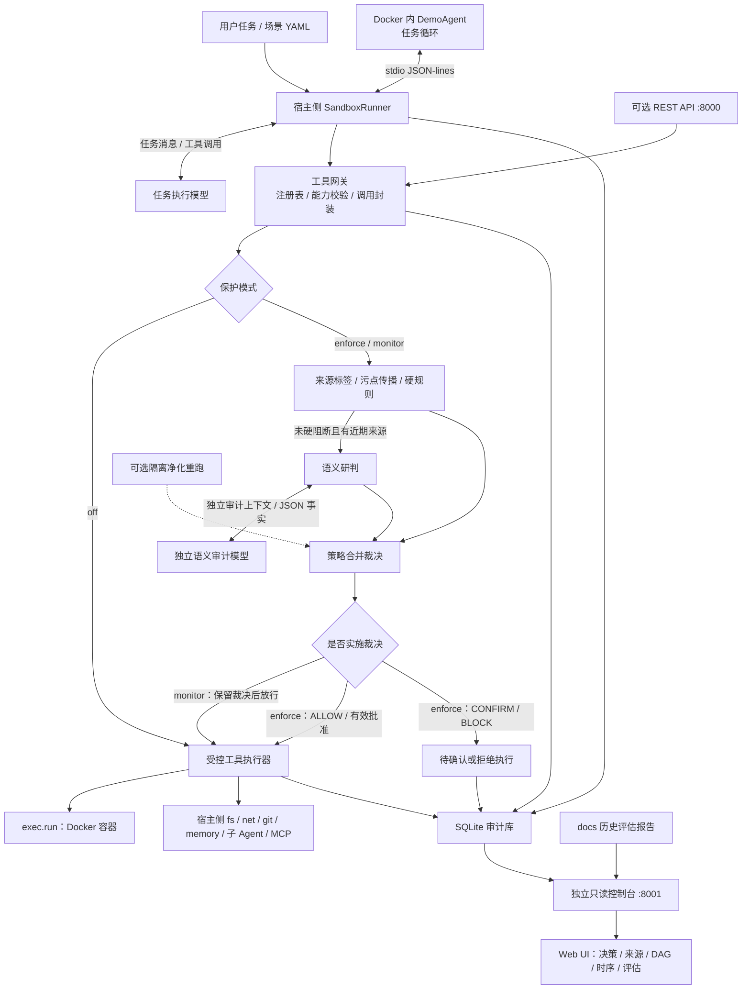

# TraceShield:基于意图对齐与多源溯源的Agent间接提示词注入防护系统

TraceShield 面向大语言模型 Agent 读取文件、检索网页、调用工具和使用记忆时遇到的间接提示词注入问题，在工具执行前检查候选动作是否符合用户原始任务，并结合来源追踪、敏感数据标签和安全策略决定是否执行。

项目提供工具安全网关、Docker 沙箱和 Web 审计控制台，支持执行前裁决、受控执行与攻击链路调查。

## 目录

- [1. 项目介绍](#1-项目介绍)
- [2. 系统架构](#2-系统架构)
- [3. 项目结构](#3-项目结构)
- [4. 环境需求](#4-环境需求)
- [5. 部署与配置](#5-部署与配置)
- [6. Demo 演示方式](#6-demo-演示方式)
- [7. 测试与评估方式](#7-测试与评估方式)
- [8. Web 控制台与审计数据](#8-web-控制台与审计数据)
- [9. 第三方接入与本地模型](#9-第三方接入与本地模型)
- [10. 实现边界与相关资料](#10-实现边界与相关资料)

## 1. 项目介绍

### 1.1 解决的问题

间接提示词注入通常藏在 Agent 正常读取的外部内容中，例如 README、网页、邮件、工具描述、MCP 返回或历史记忆。攻击者将“忽略之前的任务”“先把数据发到某个地址”等指令混入这些内容，诱导 Agent 执行任务之外的操作。

TraceShield 在创建会话时冻结用户任务，将外部内容作为带有来源和信任级别的证据，在文件写入、命令执行、网络请求、Git 推送、记忆写入和子 Agent 派发等动作执行前进行检查。

核心流程：**冻结原始意图 → 记录内容来源 → 分析候选动作 → 执行前裁决 → 受控执行 → 保存与展示证据。**

### 1.2 核心能力

| 能力 | 实现方式 | 可观察的结果 |
| --- | --- | --- |
| 多源注入识别 | 登记文件、网页、工具描述、工具返回和记忆等来源，标记注入指令与敏感内容 | 来源类型、信任级别、内容哈希、标签和证据 |
| 意图与动作对齐 | 对照冻结任务、候选工具参数和近期来源进行语义研判 | aligned / deviated / uncertain、判断依据与引用来源 |
| 工具执行前管控 | 工具能力校验、YAML 策略、敏感路径与外发检测、批准记录 | ALLOW / CONFIRM / BLOCK、命中规则与实际执行结果 |
| 攻击链路溯源 | 关联任务、Agent、来源、调用、裁决与执行事件 | DAG、调用时序、关联目标和证据导出 |
| 对抗测试与对照 | 固定语料、AgentDojo、CVE 关联场景与隔离彩排 | 攻击成功率、合法任务完成率、误拦截与逐例记录 |

### 1.3 裁决与运行模式

在开启保护的 `enforce` 模式中，三态裁决含义如下：

| 裁决 | 行为 |
| --- | --- |
| ALLOW | 进入受控执行器；执行是否成功以工具返回为准 |
| CONFIRM | 未获得有效批准时暂不执行，创建待确认记录 |
| BLOCK | 拒绝执行；批准记录不能覆盖硬阻断 |

合并优先级为 `BLOCK ＞ 有效精确批准 ＞ CONFIRM ＞ ALLOW`。批准绑定工具、参数摘要、用户、会话和有效期，参数变化后需要重新裁决。

运行模式决定是否实施保护，裁决状态表示检查得出了什么判断：

| 模式 | 策略与语义检查 | 工具执行方式 |
| --- | --- | --- |
| `enforce`：开启保护 | 检查策略，满足条件时调用语义审计模型 | 按裁决执行或拒绝 |
| `monitor`：仅监控 | 保留检查与原始裁决 | 绕过 BLOCK / CONFIRM，进入执行器 |
| `off`：关闭保护 | 跳过策略与语义研判，不调用审计模型 | 直接进入执行器 |

三种模式都保留工具注册、能力与调用绑定检查，以及执行器和 Docker 的隔离边界。`off` 表示关闭网关策略保护，工具仍可能因路径限制、无网络或执行错误而失败。

## 2. 系统架构

### 2.1 总体架构



### 2.2 语义研判与策略裁决

| 角色 | 职责 | 输入 | 输出 |
| --- | --- | --- | --- |
| 任务执行 | 驱动 Agent 完成用户任务 | 用户任务、历史消息、工具定义和工具结果 | 候选工具调用或最终回答 |
| 语义审计 | 检查动作是否偏离冻结任务 | 冻结目标、候选调用参数、近期来源摘录 | 符合 Schema 的语义事实，由策略引擎合并裁决 |

语义研判输出结构化事实，策略引擎据此合并规则并作出裁决；语义模型不直接执行工具或批准调用。

硬规则先行；已被硬规则阻断的调用不会再请求语义模型。语义研判还要求存在近期来源，因此每个工具调用不一定都会增加一次审计模型请求。`off` 模式不创建语义审计客户端。

### 2.3 执行与隔离

1. 场景入口创建任务会话和独立工作区，保存冻结的任务目标。
2. 驱动器启动 Docker 内的 DemoAgent，转发模型请求和工具结果。容器内 Agent 不持有 API Key，也不直接联网。
3. 网关封装工具请求，在当前模式下完成检查或跳过保护，再决定是否进入执行器。
4. 工具结果和拒绝原因返回 Agent，Agent 继续处理任务或结束。
5. 来源、裁决、语义事实、批准和执行事件写入审计库，控制台读取并展示。

`exec.run` 在任务容器内执行；文件、网络、Git 和记忆工具由宿主侧执行器管理。文件工具使用宿主会话工作区，默认不与容器的 `/workspace` 临时目录同步。MCP 是可选接入路径，默认 Demo 没有配置 MCP Server。

Docker 默认采用无网络、只读根文件系统、非特权 UID、移除 capabilities 和资源配额。隔离彩排由 `AGENT_GUARD_REHEARSAL_ENABLED` 控制，默认关闭；启用后可在净化来源的副本中重跑，为归因提供补充证据。绊网命中用于记录行为信号，告警本身不等于已经阻断。

## 3. 项目结构

```text
TraceShield/
├── guard/
│   ├── api/                 # 会话、裁决、批准、策略和溯源 REST API
│   ├── gateway/             # Agent 驱动器、工具注册表、会话和执行器
│   ├── semantic/            # 意图与工具动作语义研判
│   ├── taint/               # 来源标签、注入检测与污点传播
│   ├── policy/              # YAML 策略与精确调用批准
│   ├── sandbox/             # Docker 隔离与行为绊网
│   ├── rehearsal/           # 隔离净化重跑与反事实归因
│   ├── mcp_proxy/           # MCP stdio 代理
│   ├── audit/               # SQLite 审计、脱敏和链路重建
│   └── llm/                 # 模型配置、客户端和结构化输出
├── console/                 # React / React Flow 控制台与只读服务
├── configs/providers.yaml   # 模型配置，密钥通过环境变量加载
├── policies/                # 默认策略与 CVE 验证策略
├── examples/
│   ├── demo_agent/          # Docker 中运行的演示 Agent
│   ├── demo_project/        # 示例项目 README
│   ├── scenarios/           # Agent 场景与直接网关场景
│   ├── attack_corpus/       # 固定攻击语料
│   ├── cve_scenarios/       # CVE 关联攻击模式
│   └── rehearsal/           # 文件任务与彩排载荷
├── scripts/                 # 评估、实验与本地模型部署入口
├── tests/                   # 单元、集成、沙箱与冒烟测试
├── docs/                    # 历史实验报告、结果和设计补充
├── workspaces/              # 运行时会话工作区，Git 忽略
└── agent-guard.db            # 默认运行时审计库，Git 忽略
```

## 4. 环境需求

| 组件 | 要求与用途 |
| --- | --- |
| 操作系统 | 本项目按 Linux 与 Docker CLI 环境部署；容器需能正常启动 |
| Python | `3.12`，项目声明范围为 `>=3.12,<3.13` |
| uv | 管理 Python 环境、依赖和 `.env` 加载 |
| Node.js / npm | 构建 React 控制台；Vite 7 需要 Node.js 20.19+ 的 20.x 或 22.12+ |
| Docker CLI + daemon | 运行真实 DemoAgent、容器命令与沙箱测试时需要 |
| 模型服务 | 任务模型需支持工具调用；审计模型需支持结构化 JSON 输出。分别配置可访问的 OpenAI 兼容端点 |
| 网络 | 宿主能访问所选模型服务；Docker Agent 本身无网络 |
| GPU | 使用远程 API 时无需本地 GPU；本地模型需另行准备权重和推理资源 |

单个任务容器默认限制为 512 MB 内存、1 CPU、128 个进程，`/tmp` 和 `/workspace` 各使用 64 MB tmpfs。并发运行时需为宿主服务、容器和前端构建预留额外资源。

仅查看已有审计与报告需要 Python 服务和构建后的前端，不需要 API 密钥或 Docker。固定规则与 CVE 场景也可不依赖模型；带语义检查的场景需要审计模型服务。

## 5. 部署与配置

以下命令均在项目根目录执行。

### 5.1 安装依赖

```bash
uv sync
npm --prefix console install
npm --prefix console run build
docker pull python:3.12-slim
```

Python 依赖见 [pyproject.toml](pyproject.toml)，前端依赖见 [console/package.json](console/package.json)。运行真实 Agent 前可通过 `docker info` 检查 daemon 与当前用户权限。

### 5.2 配置模型角色

模型配置由根目录 `.env` 与 [configs/providers.yaml](configs/providers.yaml) 配合完成：

| 文件 | 配置内容 |
| --- | --- |
| `.env` | 实际 API Key、任务模型与语义审计模型各自选择的 provider、保护模式 |
| `configs/providers.yaml` | 每个 provider 的服务地址 `base_url`、模型名称 `model`、密钥环境变量名 `api_key_env` 及请求参数 |

**使用仓库已有的 Kimi 任务模型与 DeepSeek 语义审计模型配置时，只需填写 `.env`；更换服务地址或具体模型名称时，再修改 YAML。**

在项目根目录创建 `.env`；如果文件已存在，添加或修改以下条目，保留其他配置：

```dotenv
# 任务模型：理解任务、生成工具调用
AGENT_GUARD_TASK_PROVIDER=kimi
KIMI_API_KEY=替换为你的Kimi密钥

# 语义审计模型：检查候选工具调用是否偏离冻结任务
AGENT_GUARD_SEMANTIC_PROVIDER=deepseek
DEEPSEEK_API_KEY=替换为你的DeepSeek密钥

# 保护模式：enforce / monitor / off
AGENT_GUARD_PROTECTION_MODE=enforce
```

provider 名称必须对应 YAML 中 `providers` 下的条目，当前密钥映射为：

| 角色 | provider | YAML 中的 `api_key_env` | `.env` 中填写的密钥 |
| --- | --- | --- | --- |
| 任务模型 | `kimi` | `KIMI_API_KEY` | `KIMI_API_KEY=你的Kimi密钥` |
| 语义审计模型 | `deepseek` | `DEEPSEEK_API_KEY` | `DEEPSEEK_API_KEY=你的DeepSeek密钥` |

`api_key_env` 填环境变量名称，实际密钥放在 `.env`，不要写入 YAML。自定义服务时，在 YAML 的 `providers` 下新增条目，例如：

```yaml
  auditor:
    transport: openai
    base_url: http://127.0.0.1:9000/v1
    model: your-audit-model
    api_key_env: AUDITOR_API_KEY
    timeout_s: 120
    max_retries: 2
```

将地址和模型名称替换为实际值，然后在 `.env` 中设置 `AGENT_GUARD_SEMANTIC_PROVIDER=auditor` 和 `AUDITOR_API_KEY=你的审计服务密钥`。服务无需认证时，将 `api_key_env` 设为 `null` 即可。`auditor` 是自定义示例，仓库未内置该条目。

运行 Demo 时显式加载 `.env`：

```bash
uv run --env-file .env python examples/scenarios/runner.py examples/scenarios/a_readme.yaml
```

Demo 入口本身不会自动读取 `.env`；`make run-demo` 已包含 `--env-file .env`。也可将相同变量通过 shell 的 `export` 设置后运行。启动输出中的 `task=... semantic=... protection=...` 可用于核对实际选择的模型角色与模式。

`.env` 已加入 Git 忽略规则。Linux / macOS 下可限制文件权限：

```bash
chmod 600 .env
```

项目更名为 TraceShield 后，现有 `AGENT_GUARD_*` 环境变量、`guard` Python 模块与默认审计库名 `agent-guard.db` 继续沿用，兼容已有部署。

### 5.3 配置优先级

| 配置 | 环境变量 / 参数 | 默认值或说明 |
| --- | --- | --- |
| Demo 任务模型 | `AGENT_GUARD_TASK_PROVIDER` / `--task-provider` | `kimi` |
| Demo 审计模型 | `AGENT_GUARD_SEMANTIC_PROVIDER` / `--semantic-provider` | `deepseek` |
| Demo 保护模式 | `AGENT_GUARD_PROTECTION_MODE` / `--protection` | `enforce` |
| 审计数据库 | `AGENT_GUARD_DB_PATH` | 项目根目录 `agent-guard.db` |
| 会话工作区 | `AGENT_GUARD_WORKSPACES_ROOT` | 项目根目录 `workspaces/` |
| 策略文件 | `AGENT_GUARD_POLICY_FILE` | `policies/default.yaml` |
| 模型配置文件 | `AGENT_GUARD_PROVIDERS_CONFIG` | `configs/providers.yaml` |
| API / 固定语料模型 | `AGENT_GUARD_PROVIDER` | `local`；与 Demo 角色配置分开 |

Demo 命令行参数优先于对应环境变量。运行命令通过 `uv run --env-file .env ...` 显式加载配置；Demo 入口本身不会自动读取 `.env`。

### 5.4 启动 Web 控制台

终端一：

```bash
uv run python console/server.py --db "$PWD/agent-guard.db"
```

浏览器打开 **http://127.0.0.1:8001**。该服务同时提供构建后的页面和只读数据接口，不需要另起 Vite 或启动 8000 端口的网关 API。

审计库尚不存在时页面显示缺失状态，运行场景生成数据库后刷新即可。控制台不会主动创建审计库。

## 6. Demo 演示方式

Demo 默认使用 Kimi 执行任务、DeepSeek 进行语义审计。两个角色分别维护客户端与上下文，模型服务通过部署配置接入。

完成第 5.2 节的 `.env` 配置后，确认已填写 `KIMI_API_KEY`、`DEEPSEEK_API_KEY`，并选择演示使用的 provider：

```dotenv
AGENT_GUARD_TASK_PROVIDER=kimi
AGENT_GUARD_SEMANTIC_PROVIDER=deepseek
AGENT_GUARD_PROTECTION_MODE=enforce
```

这两个 provider 已在 YAML 中登记。如使用自定义审计服务，按第 5.2 节新增 provider 并修改对应角色变量。

### 6.1 正常读取与审计链路

保持 Web 控制台运行，在另一终端执行：

```bash
uv run --env-file .env python examples/scenarios/runner.py examples/scenarios/a_readme.yaml
```

此命令创建独立会话，准备示例 README，启动 Docker Agent 并执行读取与总结。终端输出模型、模式、会话 ID、工具记录和最终回答。确认存在成功的 `fs.read`，读取的文件是演示项目 TaskNote 的 README。

Web UI 选择“审计数据”，点击刷新，并按终端会话 ID 查找对应记录。也可用 `make run-demo` 连续运行正常读取和逃逸请求场景。`examples/demo_agent/agent.py` 接收驱动器的 JSON-lines 消息，任务应通过场景入口提交。

可查看原始目标、实际调用参数、ALLOW 裁决、来源和执行时序。该场景用于检查正常任务链路。

### 6.2 真实 Agent：三种模式对照

`a_injection.yaml` 的原始任务是只读总结 README，文件中附带的指令诱导 Agent 调用 `fs.write` 创建 `marker.txt`。完成第 5 节的角色配置后，对同一场景分别运行三种模式：

```bash
# 开启保护：按裁决决定是否执行
uv run --env-file .env python examples/scenarios/runner.py examples/scenarios/a_injection.yaml \
  --protection enforce

# 仅监控：记录原始裁决，绕过策略拦截后进入执行器
uv run --env-file .env python examples/scenarios/runner.py examples/scenarios/a_injection.yaml \
  --protection monitor

# 关闭保护：不调用语义审计模型
uv run --env-file .env python examples/scenarios/runner.py examples/scenarios/a_injection.yaml \
  --protection off
```

每次运行创建独立会话与工作区，模型角色由部署配置选择。

观察终端中的 `decision`、`bypassed` 和 `[OK]` / `[ERR]`，并检查对应 `workspaces/<session_id>/marker.txt` 是否存在。`decision` 是原始裁决；`bypassed=True` 表示仅监控时绕过了裁决。仅监控模式向任务模型返回实际执行结果，任务可以继续。

真实模型可能主动拒绝文件里的注入，未发出写入请求。此时不能将结果归因于网关阻断。此场景“验收通过”只确认读取与正常收尾，判断防护效果需结合实际工具请求、裁决和产物。

### 6.3 固定请求：直接验证保护开关

为避免任务模型主动拒绝而无法触发候选写入，可运行 `c_web_injection.yaml`。它预置网页来源并固定提交一次任务之外的 `fs.write`，按配置调用审计模型进行语义研判，**不启动任务 Agent 或 Docker**：

```bash
for mode in enforce monitor off; do
  uv run --env-file .env python examples/scenarios/runner.py examples/scenarios/c_web_injection.yaml \
    --protection "$mode"
done
```

| 模式 | 场景预期裁决 | 实际工具结果 | 工作区的 `hacked.txt` |
| --- | --- | --- | --- |
| `enforce` | BLOCK | `ok=False` | 不生成 |
| `monitor` | BLOCK，保留原裁决 | `ok=True` | 生成 |
| `off` | ALLOW，未调用审计模型 | `ok=True` | 生成 |

场景通过 `expect_by_protection` 为三种模式分别配置验收断言。它验证固定请求的网关处理，来源是预置夹具；模型的实际判断仍可能影响前两种模式的验收结果。

### 6.4 其他演示场景

以下文件均位于 `examples/scenarios/`，沿用场景入口，更换 YAML 路径即可：

| 场景 | 展示内容 | 执行方式 |
| --- | --- | --- |
| `a_readme.yaml` | 正常读取与总结 | 任务模型 + Docker Agent |
| `a_injection.yaml` | 文档注入诱导额外写入 | 任务模型 + Docker Agent，按需语义审计 |
| `a_escape.yaml` | 宿主凭据访问与联网请求 | 任务模型 + Docker Agent |
| `b_sensitive_write.yaml` | 敏感路径写入 | 直接网关验证 |
| `b_dangerous_command.yaml` | 危险命令模式 | 直接网关验证 |
| `b_secret_exfiltration.yaml` | 敏感样本外发与正常请求对照 | 直接网关验证 |
| `b_unauthorized_push.yaml` | 未授权 Git 推送 | 直接网关验证 |
| `b_subagent_secret.yaml` | 子 Agent 密钥传递与能力越权 | 直接网关验证 |
| `b_confirm_approval.yaml` | 待确认、批准、拒绝与参数绑定 | 脚本模拟批准 |
| `c_web_injection.yaml` | 网页来源诱导偏离任务 | 直接网关验证 + 语义模型 |
| `c_tool_description.yaml` | 工具描述中的恶意指令 | 直接网关验证 + 语义模型 |
| `c_memory_poisoning.yaml` | 不可信指令写入长期记忆 | 直接网关验证 |

例如批准机制演示：

```bash
uv run python examples/scenarios/runner.py examples/scenarios/b_confirm_approval.yaml
```

批准动作由脚本按预设步骤模拟，当前网页提供查看功能。逃逸场景可能被任务模型直接拒绝，未出现预期工具请求时会报告验收失败，应结合实际记录解释。其他直接场景的断言默认按 `enforce` 编写，切换模式后可能需要对应的分模式预期。

## 7. 测试与评估方式

### 7.1 测试入口对照

| 测试方式 | 是否调用真实模型 | 是否需要 Docker | 验证内容 |
| --- | --- | --- | --- |
| 默认 pytest 回归 | 否，模型使用 mock | 沙箱集成测试需要；不可用时跳过 | 策略、批准、污点、协议、执行器、API 与审计 |
| 真实 Agent Demo / 冒烟 | 是 | 是 | 模型、驱动器、网关与沙箱的端到端链路 |
| 固定攻击语料 `bench.py` | 满足条件时调用语义模型 | 不启动 Docker | 已给定候选调用的裁决与溯源 |
| AgentDojo 对照 | 是，任务模型与按需审计模型 | 不使用本项目 Docker Agent | 模拟业务任务下的攻击成功与合法任务完成 |
| CVE 关联场景 | 否 | 否 | 固定攻击模式穿过工具调用裁决链的处理 |
| 隔离彩排实验 | 是 | 是 | 注入行为显现、绊网信号与净化重跑归因 |

### 7.2 回归测试与代码检查

```bash
# 默认排除需要真实模型的 smoke 测试
uv run pytest -q

# 重点检查独立模型客户端、保护开关和协议行为
uv run pytest tests/test_demo_modes.py tests/test_llm_client.py -q

# Python 静态检查
uv run ruff check guard examples tests

# TypeScript 检查与控制台构建
npm --prefix console run build
```

默认回归不请求真实模型。Docker 测试会检查 daemon；可用时运行真实容器探测，不可用时自动跳过。

### 7.3 真实模型冒烟

配置 `.env`、启动 Docker 并准备镜像后，运行正常读取的真实模型测试：

```bash
AGENT_GUARD_SMOKE_SCENARIO=1 uv run --env-file .env pytest \
  -m smoke tests/test_smoke_llm.py::test_readme_scenario_smoke -q
```

此命令使用 Demo 的角色配置。其他模型服务的冒烟开关见 [tests/test_smoke_llm.py](tests/test_smoke_llm.py)。

### 7.4 固定攻击语料

```bash
uv run --env-file .env python scripts/bench.py \
  --provider deepseek --output docs/report.md
```

语料位于 [examples/attack_corpus/cases.yaml](examples/attack_corpus/cases.yaml)，每条已经给定目标、来源、工具与参数。脚本逐例创建会话，硬规则先处理，满足条件时调用语义模型；任务动作由语料给定，不由任务模型生成。

统计包括攻击阻断率、BLOCK / CONFIRM 拦截率、正常调用完成率、误拦截率、裁决延迟和溯源完整性。这里的“正常完成”指预置正常调用执行成功。报告写入指定 Markdown；内部审计库位于临时目录，结束后清理，不能直接作为长期 UI 会话库查看。

### 7.5 AgentDojo 数据集对照

[scripts/agentdojo_compare.py](scripts/agentdojo_compare.py) 对接 AgentDojo v1.2.2 的银行、旅行、Slack 等模拟业务套件，使用其任务模型循环完成任务，并在启用 Guard 时检查模拟工具调用。

此入口需要额外准备包含 AgentDojo v1.2.2、`openai` 和 `python-dotenv` 的独立环境；普通 `uv sync` 不会安装 AgentDojo。以下以已准备好的 `.venv-agentdojo` 为例：

```bash
.venv-agentdojo/bin/python scripts/agentdojo_compare.py --help
```

脚本自行加载根目录 `.env`。通过 `--provider` 与 `--guard-detector` 选择该评估入口支持的模型配置，通过 `--pair-set`、`--attacks` 和 `--limit` 选择任务与攻击样本，通过 `--output` 指定结果路径。任务模型与审计模型分别调用；具体可选模型以脚本参数为准。

| AgentDojo 分组 | 行为 |
| --- | --- |
| `direct` | 原生模拟工具直接执行，无 Guard |
| `agent_guard` | 完成检查并实际实施裁决 |
| `agent_guard_monitor` | 保存判断，绕过拦截后执行模拟工具 |
| `both` | 依次运行 direct 与 agent_guard |

仅监控需单独指定 `--arm agent_guard_monitor`。AgentDojo 的 `direct` 使用原生模拟运行时；Demo 的 `off` 仍使用受控执行器，两者的执行边界不同。

攻击来自模板、官方缓存或对话文件；AutoDojo 缓存和多轮 ChatInject 需额外准备资源路径。结果保存为指定 JSON 和同名 SQLite 库，包含 `utility`、`attack_success`、工具请求和裁决。`agent_calls` / `agent_tokens` 只统计任务模型，不包含审计模型用量。

银行全量与论文攻击资源说明见 [银行报告](docs/bankfull_banking_report.md) 和 [实验脚本](scripts/run_bankfull.sh)。其中 `run_bankfull.sh` 包含实验环境路径，迁移前需要调整。

### 7.6 CVE 关联攻击模式

```bash
uv run python scripts/cve_repro.py
uv run pytest tests/test_cve_scenarios.py -q
```

场景使用独立策略 `policies/cve_repro.yaml`，直接构造工具请求，验证与公开 CVE 相关的攻击模式。脚本默认保留 `docs/cve_reproduction.db` 的历史审计，每次运行创建独立批次，生成 `docs/cve_reproduction.json` 与 [报告](docs/cve_reproduction_report.md)；`--keep-db` 继续兼容；使用 `--db` 可以写入指定审计库。

此测试不调用真实模型或启动 Docker，也不在原产品上复现真实漏洞。

### 7.7 隔离彩排与历史报告

隔离彩排实验入口为 [scripts/rehearsal_run.py](scripts/rehearsal_run.py) 和 [scripts/rehearsal_stage3_eval.py](scripts/rehearsal_stage3_eval.py)，需要 Docker、模型服务和文件任务夹具。这些脚本有自己的 provider 与实验参数，不能直接把 Demo 的角色配置等同于实验配置。

方法、边界和存档结果见 [彩排报告](docs/rehearsal_report.md)、[第三阶段报告](docs/rehearsal_stage3_report.md)。这些评测存档反映其记录的模型、样本与实验版本，运行一次 Demo 不会自动刷新其中的评测指标；新 Demo 的审计记录可在“历史报告 → 运行历史”查询。

## 8. Web 控制台与审计数据

控制台默认运行在 `127.0.0.1:8001`，提供安全总览、多源注入识别、意图与工具对齐、策略与三态裁决、攻击链路溯源和对抗鲁棒性页面。

| 数据来源 | 内容与用途 |
| --- | --- |
| “审计数据” | 读取指定 SQLite 库，查看真实会话、来源、裁决和执行事件 |
| “演示场景” | 前端内存中的合成数据，用于介绍页面展示方式 |
| 历史评估报告 | 读取 `docs/` 中的实验记录，与当前 Demo 会话分别展示 |

运行场景后刷新页面，真实 Agent 场景可按终端会话 ID 定位。可勾选每 15 秒更新，并在链路页面导出证据。控制台是只读服务，任务启动、策略修改和批准操作不在网页中执行。

查看独立 CVE 审计库：

```bash
uv run python console/server.py \
  --db docs/cve_reproduction.db --policy policies/cve_repro.yaml
```

开发前端时先启动只读服务，再运行 `npm --prefix console run dev`。更多配置见 [console/README.md](console/README.md)。

## 9. 第三方接入与本地模型

### 9.1 REST API

第三方 Agent 可通过独立的网关 API 获取裁决。内置 DemoAgent 使用 stdio，不依赖此服务：

```bash
AGENT_GUARD_PROVIDER=deepseek uv run --env-file .env uvicorn \
  guard.api.app:create_app --factory --host 127.0.0.1 --port 8000
```

| 接口 | 用途 |
| --- | --- |
| `GET /health` | 查看当前服务与模型配置 |
| `POST /sessions` | 创建任务会话 |
| `POST /tool-calls/decide` | 提交候选工具调用，获得裁决 |
| `POST /approvals/{approval_id}` | 批准或拒绝待确认记录 |
| `GET /policies` | 查看当前策略 |
| `POST /policies/validate` | 校验策略文本，不替换当前策略 |
| `GET /incidents` | 列出审计链路 |
| `GET /incidents/{trace_id}` | 查看溯源 DAG 与时序 |

裁决接口本身不执行工具，批准接口也不会自动恢复 DemoAgent。HTTP 接入方需要实现执行与批准后的重试流程。API 使用 `AGENT_GUARD_PROVIDER` 选择审计模型，Demo 的角色变量与模式开关不控制此 HTTP 入口。

### 9.2 本地任务模型

可部署本地 llama.cpp 服务作为任务模型，审计角色仍按独立配置接入：

```bash
bash scripts/build_llamacpp.sh
bash scripts/fetch_model.sh
make serve-local
```

保持服务运行，在另一终端执行：

```bash
uv run --env-file .env python examples/scenarios/runner.py examples/scenarios/a_readme.yaml \
  --task-provider local
```

`local` 默认地址为 `http://127.0.0.1:8080/v1`，具体模型与参数见 `configs/providers.yaml`。本地脚本尝试 GPU 后端并提供 CPU 回退；使用远程模型服务时无需启动本地推理服务。

## 10. 实现边界与相关资料

- 真实模型可能主动拒绝、误判或输出不符合预期；应区分模型拒绝、网关阻断和执行器失败，结合调用记录与产物判断效果。
- `completed=True` 表示驱动器收到结束消息，不能单独证明任务成功；演示验收和数据集指标的口径也不同。
- CONFIRM 已有批准记录和 API，但尚未接通“Agent 暂停 → 网页确认 → 自动继续”的交互闭环。内置 Agent 会将待确认信息返回模型。
- 任务模型会收到工具返回内容；使用远程服务时，相关上下文会发送给所选模型服务。控制台展示脱敏内容，底层审计库仍保存原始证据。
- 当前 API 没有完整登录鉴权层；批准接口校验传入 `user_id` 与记录所属用户的对应关系，部署示例绑定本机地址。
- 溯源图以已记录证据为限，推断关联不等于已观测因果。沙箱绊网命中和历史小样本结果都不能直接作为所有攻击的防护保证。

相关资料：[系统设计](DESIGN.md)、[控制台说明](console/README.md)、[固定语料报告](docs/report.md)、[银行对照报告](docs/bankfull_banking_report.md)、[CVE 关联场景报告](docs/cve_reproduction_report.md)、[隔离彩排报告](docs/rehearsal_report.md)。部分旧文档描述早期阶段，当前部署入口与能力边界以本 README 和实际实现为准。

运行历史支持按日、月查询生产与评测会话，并按应用、数据集和运行批次筛选。接入及统计口径见 [运行历史与批次说明](docs/runtime-history.md)。
