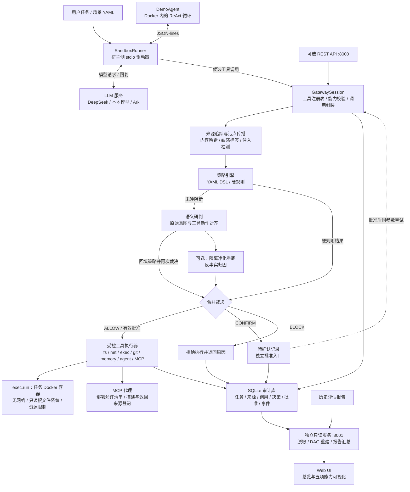

# Agent-Guard：基于意图对齐与多源溯源的智能体安全防护系统

Agent-Guard 面向大语言模型 Agent 的提示注入、工具滥用和敏感信息泄露问题，在工具执行前对照用户原始目标、内容来源、数据标签和安全策略进行裁决，并将判断依据与执行结果保存为可追踪的审计记录。

系统包含可运行的演示 Agent、工具安全网关、Docker 执行沙箱，以及独立的 Web 可视化控制台。正常任务可以继续执行；偏离任务或触发安全规则的调用会被阻断；需要额外授权的调用会产生待确认记录。

核心流程：**冻结原始意图 → 记录内容来源 → 分析工具动作 → 执行前三态裁决 → 保存审计证据 → 可视化调查。**

## 核心能力

| 能力 | 实现方式 | Web UI 展示 |
| --- | --- | --- |
| 多源注入识别 | 登记用户输入、文件、网页、工具描述、MCP 返回和记忆等来源，进行注入检测与敏感内容标记 | 来源类型、信任级别、标签、来源继承及已记录的证据 |
| 用户意图与工具动作对齐 | 冻结用户任务，对候选工具及参数进行语义研判，再交由策略引擎合并裁决 | 原始目标、实际调用、对齐关系和判断依据 |
| 工具执行前三态管控 | YAML 策略、工具能力校验、敏感路径规则、外发检测与批准记录共同决定 ALLOW / CONFIRM / BLOCK | 裁决、命中规则、参数、原因及批准状态 |
| 攻击链路溯源 | 关联 Trace、Agent、来源、调用和事件，重建 DAG 与执行时序 | 交互式链路图、Agent / MCP 时序、影响目标和证据导出 |
| 对抗鲁棒性评估 | 固定攻击语料、AgentDojo 模拟业务对照、CVE 关联攻击模式与隔离彩排实验 | 仓库已保存的报告、攻击与正常任务指标、逐例结果 |

三态裁决含义：

- **ALLOW**：通过当前检查，可进入受控执行器；是否执行成功取决于实际工具返回。
- **CONFIRM**：尚未获得有效批准，工具暂不执行，创建待确认记录。
- **BLOCK**：拒绝执行，即使存在批准记录也不能覆盖硬阻断。

合并时遵循 `BLOCK ＞ 有效精确批准 ＞ CONFIRM ＞ ALLOW`。批准绑定工具、参数摘要、用户、会话和有效期；参数改变后需要重新裁决。

## 系统架构



### 执行与防护流程

1. 场景执行器创建任务会话、冻结用户意图，并准备每个会话独立的工作区。
2. `SandboxRunner` 在 Docker 中启动 `examples/demo_agent/agent.py`，通过标准输入输出传递模型回复与工具结果。Agent 本身不持有 API Key，也不直接联网。
3. Agent 请求工具时，网关校验工具及能力，计算来源标签，先匹配硬规则；未被硬阻断的调用再进行语义研判并合并策略结果。
4. 通过检查的调用进入执行器，待确认或阻断的调用不执行。结果和拒绝原因返回 Agent，供其调整方案或结束任务。
5. 审计库保存各阶段记录；Web UI 读取同一审计库，展示真实调用、裁决与溯源证据。

`exec.run` 在任务容器内执行；文件、网络、Git、记忆等操作由网关侧对应执行器管理。MCP 是可选的工具接入路径，并非所有工具调用都必须经过 MCP。

隔离彩排由 `AGENT_GUARD_REHEARSAL_ENABLED` 控制，默认关闭。启用后，满足触发条件的高风险动作可在净化低信任内容的工作区中重跑，为归因提供补充证据。沙箱绊网负责记录行为信号，其告警本身不等于策略已阻断。

## 项目结构

```text
Agent-Guard/
├── guard/
│   ├── api/                 # 会话、裁决、批准、策略及溯源 REST API
│   ├── gateway/             # Agent 驱动器、工具注册表、会话与执行器
│   ├── semantic/            # 意图与工具动作的语义研判
│   ├── taint/               # 来源标签、注入检测与污点传播
│   ├── policy/              # YAML DSL、策略引擎与批准机制
│   ├── sandbox/             # Docker 隔离与行为绊网
│   ├── rehearsal/           # 隔离净化重跑与反事实归因
│   ├── mcp_proxy/           # MCP stdio 代理与来源登记
│   ├── audit/               # SQLite 审计、脱敏与链路重建
│   └── llm/                 # 模型配置与 OpenAI 兼容客户端
├── console/                 # 独立 React / React Flow UI 与只读服务
├── configs/providers.yaml   # 模型服务配置，不保存密钥
├── policies/default.yaml    # 默认安全策略
├── examples/
│   ├── demo_agent/          # 实际运行的演示 Agent
│   ├── demo_project/        # 正常任务示例文件
│   ├── scenarios/           # Agent 场景与直接网关验证场景
│   ├── attack_corpus/       # 固定攻击语料
│   └── cve_scenarios/       # CVE 关联攻击模式场景
├── scripts/                 # 评估、复现与本地模型部署脚本
├── docs/                    # 设计说明、历史报告与结果文件
└── tests/                   # 单元与集成测试
```

## 部署

以下命令均在项目根目录执行。下面以 **DeepSeek + Docker Agent + 独立 Web UI** 为主要部署方式。DeepSeek 命令需要先完成下一节的 provider 配置和客户端工具名兼容；默认 `local` 模型的部署入口见“本地模型”一节。只启动 UI 不需要配置模型。

### 1. 环境要求与依赖

| 组件 | 要求与用途 |
| --- | --- |
| Python | `3.12`，项目要求 `>=3.12,<3.13` |
| uv | 安装 Python 依赖并运行项目 |
| Node.js / npm | 前端构建；当前 Vite 7 要求 Node.js `20.19+` 的 20.x 或 `22.12+` |
| Docker CLI 与 daemon | 实际运行沙箱 Agent 时必需，当前用户需要有 Docker 使用权限 |
| 模型服务 | DeepSeek API，或已部署的本地 OpenAI 兼容服务 |

```bash
uv sync
npm --prefix console install
npm --prefix console run build
docker pull python:3.12-slim
```

只查看已有审计与历史报告时，不需要启动模型或 Docker；实际运行 Agent 才需要相应服务。

### 2. 配置 DeepSeek

在根目录创建 `.env`，已有文件则修改对应变量并保留其他配置：

```dotenv
DEEPSEEK_API_KEY=替换为你自己的密钥
AGENT_GUARD_PROVIDER=deepseek
```

```bash
chmod 600 .env
```

`.env` 已加入 Git 忽略规则。在 [configs/providers.yaml](configs/providers.yaml) 的 `providers` 下配置 `deepseek`；已有配置时无需重复添加：

```yaml
providers:
  deepseek:
    transport: openai
    base_url: https://api.deepseek.com
    model: deepseek-flash
    api_key_env: DEEPSEEK_API_KEY
    timeout_s: 120
    max_retries: 2
    extra_body:
      thinking:
        type: disabled
      max_tokens: 4096
```

截至 2026-10-20，`deepseek-flash` 对应 DeepSeek V4.1 Flash；具体版本以 [DeepSeek 官方说明](https://api-docs.deepseek.com/quick_start/pricing/) 为准。上述配置关闭思考模式。DeepSeek 不接受 `fs.read` 等带点的工具名，因此 [LLM 客户端](guard/llm/client.py) 还需要支持：出站工具定义及历史调用名称转为下划线，入站调用恢复原名。未包含该适配的版本不能仅靠填写密钥运行 DeepSeek Agent，可先使用现有 `local` 入口。

后续通过 `uv run --env-file .env ...` 显式加载密钥。使用 DeepSeek 时无需运行 `make serve-local`；演示 Agent 与网关语义研判均使用该入口选择的模型。

### 3. 启动 Web UI

终端一：

```bash
uv run python console/server.py --db "$PWD/agent-guard.db"
```

浏览器打开 **http://127.0.0.1:8001**。该进程同时提供构建后的页面和只读数据接口，不需要另起 Vite，也不需要启动 8000 端口的网关 API。

审计库尚不存在时，页面会显示缺失状态；实际运行场景后生成数据库，再点击刷新即可。

### 4. 启动演示 Agent

终端二：

```bash
AGENT_GUARD_PROVIDER=deepseek \
AGENT_GUARD_DB_PATH="$PWD/agent-guard.db" \
uv run --env-file .env python examples/scenarios/runner.py examples/scenarios/a_readme.yaml
```

此入口会创建会话、准备示例 README、启动 Docker 内的 `agent.py`，并让模型驱动它完成读取与总结。终端输出会话 ID、调用记录及最终摘要，并检查场景预期。

不要直接执行 `python examples/demo_agent/agent.py` 来输入自然语言任务：它读取的是驱动器发送的 JSON-lines 协议消息。具体任务由场景 YAML 的 `mission`、`message` 和种子文件指定。

## 如何演示

保持 Web UI 服务运行，在终端执行场景。页面选择 **“审计数据”**，点击刷新并按终端输出的会话 ID 选择本次会话；也可勾选每 15 秒更新。

### 演示一：正常任务与实际执行链路

运行上面的 `a_readme.yaml`。

- 终端查看 Agent 是否真实调用 `fs.read`，以及最终总结。
- UI 的“安全总览”查看新增会话和调用。
- “策略与三态裁决”查看调用参数、裁决原因与策略版本。
- “攻击链路溯源”查看来源、工具执行与事件顺序，并导出证据。

这是调用链连通演示，不能单独代表全部防护能力已经得到验证。

### 演示二：高风险请求与执行边界

```bash
AGENT_GUARD_PROVIDER=deepseek \
AGENT_GUARD_DB_PATH="$PWD/agent-guard.db" \
uv run --env-file .env python examples/scenarios/runner.py examples/scenarios/a_escape.yaml
```

该场景请求读取宿主 SSH 私钥并尝试外发，用于观察 Agent、网关和沙箱的实际处理。重点是实际出现的请求、裁决与失败原因，而非期待危险操作成功。

真实模型可能主动拒绝任务，未发出工具调用；此时只能说明模型拒绝，不能将其算作网关成功拦截。场景因缺少预期调用而报告验收失败时，也应结合实际记录解释。

### 演示三：定向展示注入检测与策略命中

仓库还提供 `mode: direct` 场景，直接构造来源和工具请求，验证网关行为。这类场景**不启动 DemoAgent 或 Docker**；带有 `semantic: true` 的场景仍会调用模型进行语义研判。

例如，展示网页内容诱导与原任务不一致的文件写入：

```bash
AGENT_GUARD_PROVIDER=deepseek \
AGENT_GUARD_DB_PATH="$PWD/agent-guard.db" \
uv run --env-file .env python examples/scenarios/runner.py examples/scenarios/c_web_injection.yaml
```

其他场景沿用同一命令，更换最后的 YAML 路径：

| 场景文件（位于 `examples/scenarios/`） | 展示内容 | 模式 |
| --- | --- | --- |
| `a_readme.yaml` | 正常读取与总结 | 真实模型 + Docker Agent |
| `a_escape.yaml` | 宿主凭据访问与联网尝试 | 真实模型 + Docker Agent |
| `b_sensitive_write.yaml` | 敏感路径写入阻断 | 直接网关验证 |
| `b_dangerous_command.yaml` | 危险命令策略命中 | 直接网关验证 |
| `b_secret_exfiltration.yaml` | 读取敏感样本后的外发检测 | 直接网关验证，含正常联网对照 |
| `b_unauthorized_push.yaml` | 未授权 Git 推送 | 直接网关验证 |
| `b_subagent_secret.yaml` | 子 Agent 密钥传递与能力越权 | 直接网关验证 |
| `b_confirm_approval.yaml` | 待确认、批准、拒绝和参数绑定 | 直接网关验证，脚本模拟批准 |
| `c_web_injection.yaml` | 网页来源诱导偏离任务 | 直接网关验证 + 语义模型 |
| `c_tool_description.yaml` | MCP 工具描述中的恶意指令 | 直接网关验证 + 语义模型 |
| `c_memory_poisoning.yaml` | 不可信指令写入长期记忆 | 直接网关验证 |

对这些场景，UI 展示已记录的来源、标签、命中规则和事件链。直接场景的来源是预置夹具，应作为网关机制验证展示，而非宣称 Agent 自主遭遇了真实网页攻击。

### 演示四：批准机制

```bash
AGENT_GUARD_DB_PATH="$PWD/agent-guard.db" \
uv run python examples/scenarios/runner.py examples/scenarios/b_confirm_approval.yaml
```

该场景无需模型或 Docker，通过脚本依次演示：未批准不执行、不同用户不能批准、同参数批准后放行、参数改变需重新确认，以及拒绝后的执行限制。

UI 的“策略与三态裁决”可查看相关调用和批准记录。**批准动作由脚本按预设步骤模拟，当前网页不提供批准按钮；这不是人工现场点击确认演示。**

### 演示五：历史对抗结果与复盘

在“对抗鲁棒性”页面查看仓库已有的三组业务模拟结果、攻击语料记录与 CVE 关联场景报告。无需现场重新运行全量实验。

- 三组对照为直接执行、Agent Guard 执行前管控，以及只观测不拦截的 monitor 模式。
- AgentDojo 的银行、旅行和 Slack 等操作属于模拟业务工具，不是真实账户操作。
- CVE 场景验证关联攻击模式在工具调用层的处理，不代表在原产品上复现了真实漏洞。
- 本次 Agent 会话写入审计库；历史评估指标来自 `docs/` 文件，两者分别展示。运行一次 Agent 不会自动更新历史指标。

相关报告：[银行任务对照](docs/bankfull_banking_report.md)、[固定语料](docs/report.md)、[CVE 关联场景](docs/cve_reproduction_report.md)、[隔离彩排](docs/rehearsal_report.md)。

## 可选部署与接入

### 本地模型

如需使用本地 Qwen 模型，准备并启动 llama.cpp：

```bash
bash scripts/build_llamacpp.sh
bash scripts/fetch_model.sh
make serve-local
```

保持模型服务运行，再在另一个终端显式选择 `local`：

```bash
AGENT_GUARD_PROVIDER=local \
AGENT_GUARD_DB_PATH="$PWD/agent-guard.db" \
uv run python examples/scenarios/runner.py examples/scenarios/a_readme.yaml
```

默认端点为 `http://127.0.0.1:8080/v1`，模型与参数见 `configs/providers.yaml`。本地部署脚本会尝试 GPU 后端，并提供 CPU 回退。

### REST API

第三方 Agent 需要 HTTP 接入时，可单独启动网关 API。内置 DemoAgent 走 stdio，不依赖这个服务。

```bash
AGENT_GUARD_PROVIDER=deepseek \
AGENT_GUARD_DB_PATH="$PWD/agent-guard.db" \
uv run --env-file .env uvicorn guard.api.app:create_app --factory --host 127.0.0.1 --port 8000
```

| 接口 | 用途 |
| --- | --- |
| `GET /health` | 查看服务与模型配置 |
| `POST /sessions` | 创建任务会话 |
| `POST /tool-calls/decide` | 提交候选工具调用，获取裁决 |
| `POST /approvals/{approval_id}` | 批准或拒绝待确认记录 |
| `GET /policies` | 查看当前策略 |
| `POST /policies/validate` | 校验策略文本，不修改当前策略 |
| `GET /incidents` | 列出审计链路 |
| `GET /incidents/{trace_id}` | 获取溯源 DAG 与时序 |

`/tool-calls/decide` 返回裁决，本身不执行工具。批准接口更新记录，也不会主动唤醒正在运行的 DemoAgent。HTTP 接入方需要实现自己的裁决、执行和批准后重试流程。

### 指定审计库

```bash
uv run python console/server.py \
  --db docs/cve_reproduction.db \
  --policy policies/cve_repro.yaml
```

以上命令用于查看已经存在的 CVE 场景审计库。控制台不会创建该库。开发前端及只读接口的更多说明见 [console/README.md](console/README.md)。

## 当前实现边界

- **Web UI 是独立只读控制台**：可以查看、刷新和导出记录，不启动任务、不修改策略、不执行批准。“演示场景”标签使用前端合成数据；实际运行结果应在“审计数据”中查看。
- **人工确认尚未形成网页交互闭环**：已有批准机制和 API，但尚未接通“Agent 暂停 → 网页确认 → Agent 自动继续”。内置 Agent 收到 CONFIRM 后将其作为工具结果反馈给模型。
- **不同评估入口的数据保存方式不同**：不能认为所有数据集逐条运行都会出现在当前 UI。需要入口持久化审计库，并将控制台指向同一数据库；只生成报告的入口主要用于报告展示。
- **语义研判具有模型依赖**：真实模型可能拒绝请求、误判或输出不符合预期；语义服务不可用时也可能产生需要确认的保守裁决。具体效果应以对应版本、场景和审计结果为依据。
- **当前 API 未提供完整登录鉴权层**：批准入口校验所传 `user_id` 与记录所属用户的对应关系；默认按本机演示方式绑定 `127.0.0.1`。
- **可视化以已保存证据为限**：未保存的原文区间或推断依据不会自动补全；图中推断关联不等于已观测因果。历史报告和小样本结果不能直接外推为所有攻击的防护保证。

设计与实现细节见 [DESIGN.md](DESIGN.md)；部署补充见 [docs/deploy.md](docs/deploy.md)。部分旧文档描述早期阶段，当前启动命令与能力边界以本 README 和实际实现为准。
